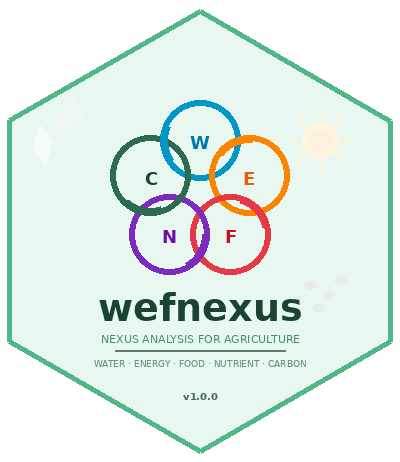

# wefnexus 

<!-- badges: start -->
[](https://CRAN.R-project.org/package=wefnexus)
<!-- badges: end -->

## Overview

**wefnexus** provides a comprehensive toolkit for analyzing
Water-Energy-Food-Nutrient-Carbon (WEFNC) nexus interactions in
agricultural production systems. It includes 68 functions across 6
modules with a nexus integration layer.

## Installation

Install from CRAN:

```r
install.packages("wefnexus")
```

## Modules

| Module | Functions | Key Metrics |
|--------|-----------|-------------|
| **Water** | 11 | WUE, WP, WF (green/blue/grey), CWSI, CWP, RUE, IWP, WSI |
| **Energy** | 14 | EUE, EROI (standard + extended), EP, EI, NER, REF, energy budget |
| **Food** | 12 | FPI, HI, LER, SPI, SYI, nutritional yield, BCR |
| **Nutrient** | 11 | AE, PE, RE, PFP, IUE, NHI, N surplus, SNI |
| **Carbon** | 10 | CF, GHG, SOC, GWP (IPCC AR6), CEI, NECB |
| **Nexus** | 10 | Composite index, trade-off matrix, sensitivity, radar, heatmap |

## Quick Example

```r
library(wefnexus)
data(arid_pulse_nexus)
d <- arid_pulse_nexus

# Compute EROI with extended analysis
e_out <- d$energy_output_grain + d$energy_output_straw
eroi(energy_out = e_out, energy_in = d$energy_input)

# Full nexus summary
nexus_summary(
  yield = d$grain_yield,
  water_consumed = d$total_water,
  energy_input = d$energy_input,
  energy_output = e_out,
  n_applied = d$n_applied,
  n_uptake = d$n_uptake,
  carbon_emission = d$ghg_emission,
  treatment_names = d$treatment
)
```

## Key Features

- **68 functions** across 6 integrated modules
- **EROI** with standard, extended, and Net Energy Ratio analysis
- **IPCC AR6 GWP** defaults: CH4 = 27, N2O = 273 (100-yr horizon)
- **Nutritional yield** analysis (protein, Fe, Zn, persons fed)
- **Nexus sensitivity analysis** for weight perturbation assessment
- **Conservation agriculture** focus (CT/ZT/PB comparisons)
- **Arid and semi-arid** environment emphasis
- **CRAN-ready**: verbose parameter, proper documentation
- **Base R graphics**: zero external plotting dependencies

## Citation

```
Rolaniya, L.K., Poonia, H., Jat, R.L., Punia, M. & Choudhary, R.R. (2026).
wefnexus: Water-Energy-Food-Nutrient-Carbon Nexus Analysis for Agronomic
Systems. R package version 1.0.0. https://CRAN.R-project.org/package=wefnexus
```

## License

GPL (>= 3)
